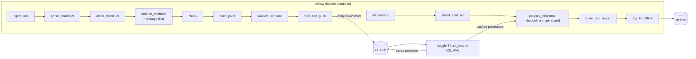

# VaidyaLM

*Vaidya* (वैद्य) means physician. This is a health-domain LLM project made of three parts:
- a QLoRA fine-tune of **Qwen2.5-1.5B-Instruct** on medical QA,
- an **Apache Airflow** ETL that turns unstructured medical text (MedQuAD XML, PubMed abstracts) into instruction data,
- an automated **PubMedQA** benchmark that measures the gains.

📈 Progress: [PROGRESS.md](PROGRESS.md) · 🗺️ Plan: [PLAN.MD](PLAN.MD) · 🎓 Learning notes: [docs/LEARN.md](docs/LEARN.md)

## Architecture


## Repository
| Path | What |
|---|---|
| `src/etl/` | pure ETL functions + `stages.py` (cached, file-based wrappers for Airflow) |
| `src/eval/` | prompts, cached batched inference, scorer, report |
| `src/train/` | QLoRA trainer + YAML configs (rank and data-mix ablations) |
| `dags/` | `preprocess_corpus`, `benchmark_models` |
| `baseline/` | naive sequential pipeline + Airflow timing script |
| `notebooks/` | Kaggle wrappers (baseline eval, training) |
| `demo/` | Gradio app for HF Spaces |

## How to run
```bash
# local Python (ETL logic, tests)
python -m venv .venv && .venv\Scripts\activate && pip install -r requirements.txt
python -m tests.test_etl && python -m src.eval.scorer

# Airflow + MLflow
copy .env.example .env        # fill in HF_TOKEN, HF_DATASET_REPO
docker compose up -d --build  # Airflow :8080, MLflow :5000
#   trigger preprocess_corpus, then benchmark_models, from the UI

# GPU work: notebooks/baseline_kaggle.ipynb, notebooks/train_kaggle.ipynb on Kaggle (T4)

# timing comparison (in/against the same container)
docker compose exec airflow python -m baseline.naive_pipeline --runs 3
python -m baseline.time_airflow --mode cold --runs 3
python -m baseline.time_airflow --mode warm --runs 3
```

## Results
*Filled in from measured runs only. See `results/` and [PROGRESS.md](PROGRESS.md).*

| Model | Prompt | Accuracy | Macro-F1 | Parse fail % |
|---|---|---|---|---|
| Base | zero-shot | – | – | – |
| Base | few-shot | – | – | – |
| Base | structured | – | – | – |
| LoRA r16 | structured | – | – | – |

| Pipeline | Mean wall-clock |
|---|---|
| Naive sequential | – |
| Airflow (cold cache) | – |
| Airflow (warm cache) | – |

## Limitations
- PubMedQA labels are yes/no/maybe; accuracy on 1,000 examples has roughly a ±3% 95% confidence interval.
- `pqa_artificial` has no "maybe" labels, so "maybe" is under-represented in training unless synthetic data is on.
- Synthetic labels come from another LLM and are filtered by cheap heuristics (self-consistency + word overlap), not by human review.
- Timing uses CPU inference with a 0.5B model on 100 examples in both pipelines; GPU numbers would differ.
- This is a research project, **not a medical device**: it is not for clinical use.
